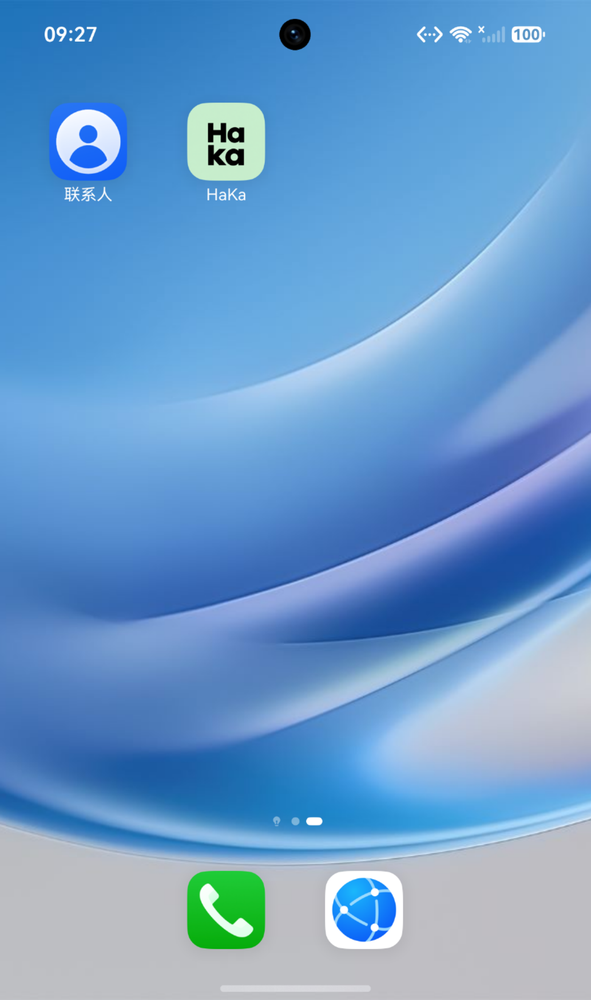

# 鸿蒙阅读体验更新（2026-11-12）

本轮基于 `0776603` 开发，随源码标签 `v1.0.1-harmony-preview.2` 发布。[Release](https://github.com/123litiany/haka_comic_harmony/releases/tag/v1.0.1-harmony-preview.2) 提供对应安装包、SHA256 和测试说明。GitHub 项目展示名称为“哔咔漫画 鸿蒙原生无广版”，手机应用名为 `HaKa`。

## 变化

- 应用显示名统一为 `HaKa`：应用级名称、Ability 默认/中文/英文标签、鸿蒙任务标题和关于页介绍均已同步；图标仍使用本轮生成的 `Ha` / `ka` 两行字母。
- 启动器应用图标、Ability 图标及启动页图标均替换为淡绿色背景、黑色 `Ha` / `ka` 两行字母。两处资源使用同一份生成图片。
- 使用鸿蒙 Input Kit 的 `inputConsumer.on('keyPressed')` 接管音量键：音量＋向前、音量－向后。每次短按翻一次；关闭开关、打开其他页面、离开阅读或进入后台时注销监听，恢复系统音量操作。保留其他平台原实现。
- 阅读设置新增“阅读时保持亮屏”和独立阅读亮度；默认亮度跟随系统。设置仅作用于阅读窗口，离开时恢复原窗口亮度和息屏行为。
- 阅读页进入后台或被其他页面覆盖时暂停自动翻页、平滑滚动，返回后恢复原模式。
- 声明平板设备支持，复用原有随窗口大小适配的界面；补齐原有章节切换触感反馈所需的 `VIBRATE` 权限。
- 构建脚本支持 `debug` / `profile` / `release`，默认使用 release/AOT，保留正常 `lib/main.dart` 入口、Rust、SQLite、插件和全部业务功能；显式关闭构建期签名，构建失败即报错。
- HAP 版本为 `1.0.1` / `1000001`，通过构建参数固定，防止 Flutter 用上游 UI 版本覆盖它。

## 构建

在已配置的英文路径工程中顺序执行，不能并行争用同一输出目录：

```powershell
.\script\harmony-build.ps1 -Architecture arm64 -BuildMode release
.\script\harmony-build.ps1 -Architecture x64 -BuildMode release
```

手机使用 ARM64 包；x64 用于模拟器。两者均须保留 `NativeAssetsManifest.json` 和正确的库映射。
新 release/AOT 包不能使用仅适用于旧 Preview 1 debug 产物的 `harmony-universal-preview.py` 合并。
未签名 HAP 仍需使用自己的有效证书和 Profile 签名。

## 图标生成记录

使用内置 `image_gen` 生图模型生成，没有使用 CLI/API fallback。最终资源：

- `ohos/AppScope/resources/base/media/app_icon.png`
- `ohos/entry/src/main/resources/base/media/icon.png`

最终提示词：

> Use case: logo-brand. Asset type: production HarmonyOS mobile app launcher icon, square 1024 by 1024. Create a very clean flat typographic app icon. Solid uniform pale pastel mint green background (#CDECCD approximately), extending to all four edges. Exactly four black Latin letters arranged as two centered lines: first line "Ha", second line "ka". Capital H, lower case a, lower case k, lower case a. Bold friendly geometric sans serif typography, crisp professional letterforms, very legible at small size. Each line the same optical width, modest line gap, perfectly centered as a compact two-line typographic mark. Keep all black letters comfortably inside the central 60 percent of the square so the launcher can crop to a rounded square or circle. Nothing else: no symbols, no comic art, no border, no extra text, no shadow, no gradients, no three-dimensional effects, no rounded outer frame. The entire image is the icon, no mockup.

## 接口依据

- [华为：系统功能键优先响应](https://developer.huawei.com/consumer/cn/doc/HarmonyOS-Guides/keypressed-guidelines/)
- [华为：inputConsumer](https://developer.huawei.com/consumer/en/doc/harmonyos-references/js-apis-inputconsumer/)
- [华为：窗口常亮与亮度](https://developer.huawei.com/consumer/en/doc/harmonyos-references-V13/js-apis-window-V13/)

接口签名同时对照本机 API 26 SDK。音量键 API 从 API 16 提供，工程最低声明为 API 18；声明和编译成功不代表所有手机已实测。

## 已完成的构建与回归

环境：DevEco SDK API 26，Flutter OHOS `3.44.9+ohos-0.0.1-canary1` / Dart 3.12.2，沿用固定工具链；未整体升级依赖。

| 架构 | 旧 debug HAP | 新 release HAP | 新包字节数 |
| --- | ---: | ---: | ---: |
| 手机 ARM64 | 124.78 MiB | 32.36 MiB | 33,933,486 |
| 模拟器 x64 | 127.02 MiB | 35.47 MiB | 37,194,587 |

ARM64 文件大小降低约 74.06%。减少来自 release/AOT、release 引擎和图标字体裁剪，保留 Rust、SQLite、导入导出、下载、网络和原有业务代码；这不是全部业务功能均已完成本轮实测的声明。

- 两种架构构建均退出 0，均为正常 `lib/main.dart` 入口、`1.0.1` / `1000001`、`debug=false`。
- 两个 HAP 均通过 `inspect_hap.py`，五个 ELF 库及两个 SQLite native-assets 映射齐全，没有 debug kernel；ARM64 手机签名和运行仍待本轮真机复测。
- HAP 中两处图标均由工具链输出为 512×512 PNG，已取出目视核对。
- `flutter test --no-pub test/network test/router test/utils test/views/reader --reporter expanded`：阅读功能更新时 47 项通过；随后仅更改显示名称，未重复业务回归，更名验证采用资源检查、两种架构构建及模拟器桌面检查。
- `flutter analyze --no-pub --no-fatal-infos lib test integration_test`：退出 0，无 error/warning，23 条既有 info。整仓扫描会额外扫描第三方包的独立样例/工具，未将其误算为应用代码检查结果。
- 已按 LF 标准化比对源目录与英文构建镜像，本轮所有代码及图标一致。
- x64 release HAP 已在原 HarmonyOS 7.0.0.107 / API 26 模拟器覆盖安装并启动；用户自行登录后进入分类首页。原有三页 `HaKa-Test-Comic` 下载仍在。

### 正常应用中的模拟器闭环

全程使用本轮 x64 release 包和正常入口，没有安装离线测试入口，没有卸载或清除应用数据。

| 检查 | 观察结果 |
| --- | --- |
| 启动器图标与名称 | 桌面实际显示淡绿色背景、黑色 `Ha` / `ka`，名称为 `HaKa`；更名包已再次覆盖安装验证 |
| 本地阅读 | 打开先前自建三页漫画，图片解码及阅读正常，可到达 1/3 和 3/3 |
| 音量键 | 模拟器硬件音量按钮和 uitest 按键均能驱动阅读；阅读时系统音量面板不出现，退出阅读后恢复系统音量面板 |
| 阅读设置 | 音量键、保持亮屏、跟随系统亮度三个开关可见，最终均恢复为开启 |
| 独立亮度 | 关闭跟随系统后，50% 亮度使系统显示 `OverrideBrightness=127`；后台撤销覆盖，回到阅读恢复；最后恢复跟随系统并确认覆盖已撤销 |
| 保持亮屏 | 阅读时系统显示本窗口 `SCREEN` 锁启用；后台/退出阅读后锁状态为 0，返回阅读后恢复为 1 |
| 系统返回 | 从设置返回阅读，再返回下载页正常，系统音量响应恢复 |
| 自动阅读暂停 | 定时器暂停/恢复和页面/应用生命周期联动由本轮回归覆盖；没有进行长时间真机耗电测试 |

本轮没有替代手机实际签名安装验证；ARM64 真机新包、平板布局、触感强度和长时间续航仍需目标设备复测。未改动在线阅读、下载、WebDAV 等业务实现，也未把它们声明为本轮完整实测通过。

启动器实测截图仅含模拟器桌面和本应用图标：



| 文件 | SHA256 |
| --- | --- |
| `haka-ohos-arm64-release-unsigned.hap` | `536307e68752643d662e489e22ec1fcdab67155896143296033cbb7497b555d0` |
| `haka-ohos-x64-release-unsigned.hap` | `91ab1e4cf283072b1966b180c69928c6ef4620d385bd005a554cf3d5d4ce5f1a` |

校验文件为交付目录内的 `SHA256SUMS.txt`，包结构报告为 `arm64-inspection.json` / `x64-inspection.json`。这些报告不验证设备签名或实际手机兼容性。
