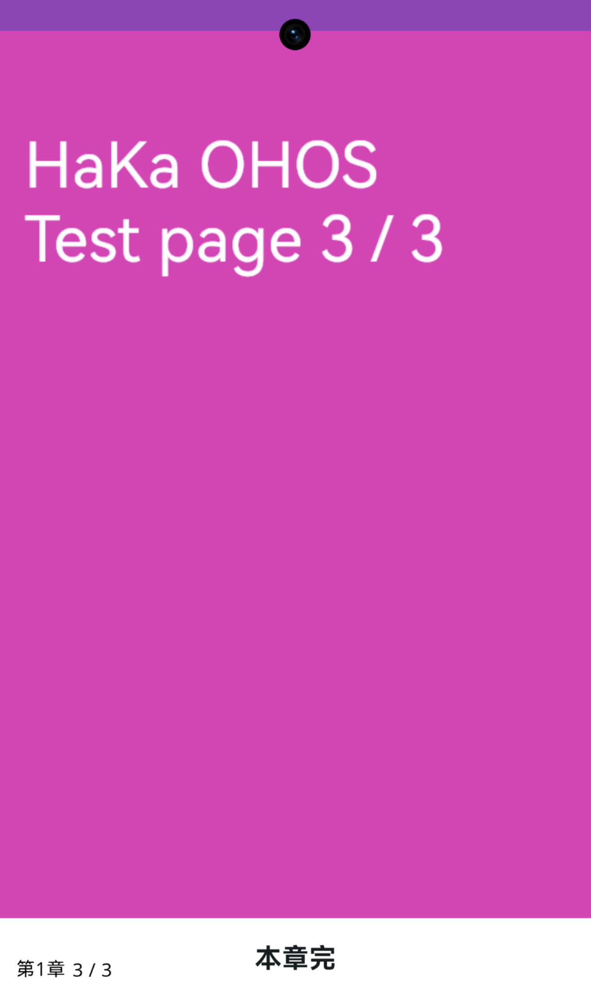

# 哔咔漫画 鸿蒙原生无广版

`HaKa` 是面向 HarmonyOS / HarmonyOS NEXT 的非官方 **鸿蒙哔咔 / 哔咔鸿蒙版（PICACG）** 客户端，基于 [raoxwup/haka_comic](https://github.com/raoxwup/haka_comic) 移植，由 [123litiany](https://github.com/123litiany) 维护。使用 Flutter OHOS 与 ArkTS 平台接口，不依赖安卓兼容环境。

> **鸿蒙预览版，尚非稳定版。** 应用名为 **HaKa**。当前 1.0.2 已在 HarmonyOS 7.0.0.107 / API 26 x64 模拟器验证；本版 ARM64 release 包需自行签名并进行真机复测。既有版本的手机测试反馈以对应 Release 为准。

[下载与版本记录](https://github.com/123litiany/haka_comic_harmony/releases) · [移植进度与构建说明](HARMONYOS.md) · [侧载安装说明](INSTALL_HARMONYOS.md) · [第三方来源](third_party/UPSTREAM.md) · [反馈问题](https://github.com/123litiany/haka_comic_harmony/issues)

## 鸿蒙版进度

**[1.0.2 Preview 3 下载与更新日志](https://github.com/123litiany/haka_comic_harmony/releases/tag/v1.0.2-harmony-preview.3)**：改进注册错误提示，增加随机昵称/登录账号生成，防止重复提交，注册成功后回填登录页 详见[注册改进记录](REGISTRATION_FIX.md)。

**[1.0.1 Preview 2 下载与更新日志](https://github.com/123litiany/haka_comic_harmony/releases/tag/v1.0.1-harmony-preview.2)**：应用显示名为 `HaKa`，增加淡绿色 `Ha` / `ka` 图标、鸿蒙音量键翻页、阅读亮屏、独立阅读亮度、后台暂停自动阅读和平板声明。改用 release/AOT 构建后，手机包约 **34 MB**，相比旧 debug 包减少约 **74%**。构建、测试范围及包体对比见 [更新记录](HARMONY_READER_UPDATE.md)。

| 功能 | 当前验证情况 |
| --- | --- |
| 启动、登录、分类、个人页 | 模拟器实测通过；重启保留登录状态 |
| 新账号注册 | 实际 Dart 接口注册及两条线路登录通过；服务端对部分随机昵称的重名响应根因未完全确认 |
| 主题与本地存储 | 模拟器实测通过 |
| SQLite、Rust ZIP | 写入重开、压缩解压内容比对通过 |
| 图片与 PDF | 自建 PNG 解码、排序和三页 PDF 结构检查通过 |
| 文档导出 | 系统保存与取消通过；大文件仍待测试 |
| ZIP/CBZ 导入与本地阅读 | 自建三页 ZIP 经系统选择器导入，阅读器显示并翻至 3/3 页；CBZ 和大文件待测 |
| 在线阅读、网络下载、WebDAV | 保留上游实现，完整流程待验证 |
| 音量键、阅读亮屏和独立亮度 | 模拟器实测通过；离开阅读后恢复系统行为 |
| 真机、签名、侧载 | 新版 ARM64 release 包待真机复测 |

HAP 下载入口在本仓库 **[Releases → Assets](https://github.com/123litiany/haka_comic_harmony/releases)**，与源码标签、SHA256 和变更说明配套。手机使用 **`haka-ohos-arm64-release-unsigned.hap`**；**x64 仅用于模拟器**。`release` 表示编译模式，当前仍是未签名预览包，需要按设备签名。使用小白调试助手前请阅读[安装说明](INSTALL_HARMONYOS.md)。

本地导入：进入「我的 → 我的下载」，点击右上角导入按钮，选择包含 JPG/PNG/WebP 漫画图片的 ZIP 或 CBZ。下载内容保存在应用内，可导出 ZIP/PDF；卸载前先导出。当前鸿蒙版不提供文件夹直接导入、自定义下载目录。`1.0.1` 及以后版本可在阅读设置中开启音量键翻页、保持亮屏和独立亮度；旧 Preview 1 不含这些新增能力。更新通过「关于 → 检查更新」打开本仓库发布页。

### 模拟器实测

以下仅为自行生成的测试图片，不含漫画服务内容或账号信息。

| 本地 ZIP 导入 | 阅读至第三页 |
| --- | --- |
|  |  |

## 开源与来源

保留上游 GPLv3 许可证、版权和历史，移植代码以同一许可证分发。引入的平台插件及其修改记录见 [third_party/UPSTREAM.md](third_party/UPSTREAM.md)。本项目不附带漫画内容、账号凭据或签名私钥。

下方保留上游介绍，其平台支持、下载地址和声明描述的是原项目；鸿蒙适配状态以上表和 `HARMONYOS.md` 为准。上游 README 中的非商业用途声明与标准 GPLv3 存在歧义，保留原文，不声称已获得额外授权或作者澄清。

---

## ⚠️ 免责声明

1. 本项目为**非官方第三方应用**，与哔咔漫画官方无任何关联
2. 仅用于**技术交流与学习**目的，禁止用于商业用途
3. 使用本软件产生的一切后果由使用者自行承担
4. 资源内容版权归原作者及平台所有，请于下载后 24 小时内删除

---
